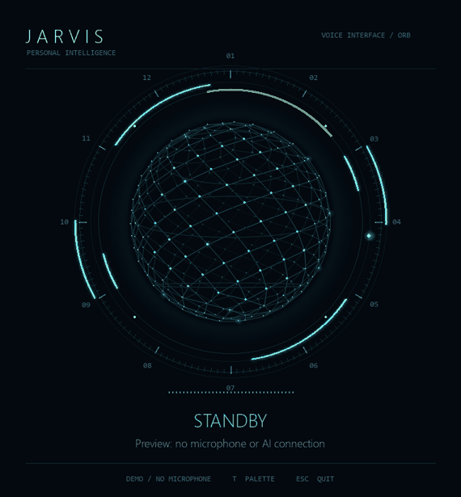

# Jarvis Orb

A Windows voice assistant with a rotating network sphere, animated HUD rings,
and a British voice. Clap twice or press **Space** to wake it, then keep talking.



The orb shows standby, listening, thinking and speaking. The speaking animation
follows actual audio playback; its waveform is decorative, not phoneme tracking.
Startup is a short greeting, with no automatic weather report.

## Get started

Use Python 3.10+ on Windows. Tested with Python 3.14.

```powershell
git clone https://github.com/Bagasanchi/jarvis-orb.git
cd jarvis-orb
python -m venv .venv
.\.venv\Scripts\python.exe -m pip install -r requirements.txt
```

1. Install [Ollama](https://ollama.com/download/windows), start it, and run
   `ollama pull qwen3.5:2b`.
2. Download [Vosk's small English model](https://alphacephei.com/vosk/models).
   Extract `vosk-model-small-en-us-0.15` into `jarvis/models/`.
   Alternatively set `JARVIS_STT_MODEL` to its extracted folder.
3. Launch the interface:

```powershell
.\.venv\Scripts\python.exe run_jarvis_face.py
```

Preview without a microphone, speech model or AI connection:

```powershell
.\.venv\Scripts\python.exe run_jarvis_face.py --demo
```

The terminal interface remains available with `python -m jarvis`.
`Start_Jarvis_Face.cmd` uses the project's virtual environment when present.

## Controls

| Control | Action |
| --- | --- |
| Double clap | Wake the assistant |
| Space or Enter | Wake, or interrupt the current spoken reply |
| "Jarvis stop", "stop talking", or "stop" | Interrupt speech using local recognition |
| T | Switch cyan / amber palette |
| Esc or close window | Quit the graphical assistant |
| Ctrl+C | Quit from the terminal |

Space and Enter work when the window has focus. After waking, the assistant
listens again after each reply. A stop-phrase listener runs during audio playback.
After interrupting, wait for **LISTENING** before asking your next question.
Space/Enter also cancels a voice reply while it is being prepared. AI requests
already in progress are not cancelled by these keys.

Voice interruption uses Vosk locally and is not acoustic echo cancellation.
Headphones are recommended: on speakers, Jarvis's own voice can be picked up
and mistaken for a stop phrase. Set `JARVIS_VOICE_INTERRUPT=0` to disable the
voice trigger while keeping keyboard interruption. If microphone monitoring
fails, keyboard interruption remains available.

## Local and cloud answers

Ollama handles everyday questions. Simple keyword rules send coding, research
and some longer questions to an optional OpenAI-compatible gateway such as
FreeLLMAPI. Automatic routing falls back to the other backend when one fails.
These rules are not a reliable measure of question difficulty.

Cloud mode is optional. Configure your own running gateway in PowerShell:

```powershell
$env:JARVIS_CLOUD_URL = "http://127.0.0.1:31415/v1"
$env:JARVIS_CLOUD_API_KEY = "YOUR_OWN_KEY"
$env:JARVIS_CLOUD_MODEL = "auto"
```

Say **"use local ..."** to force local inference without cloud fallback, or
**"use cloud ..."** to force the gateway. No account or key is included.
The `.env.example` lists settings; `.env` files are not loaded automatically.
FreeLLMAPI is a separate project and is not installed by Jarvis.

Speech recognition uses Vosk locally. Voice synthesis uses Microsoft's online
Edge TTS service, and requested weather uses wttr.in. This is therefore **not a
fully offline assistant**. Cloud requests include recent conversation history.

## Supported actions

- Short spoken AI conversations.
- App-launch commands such as "open notepad" or "launch calculator".
- Weather questions such as "what is the weather in Tokyo?".

App launching uses a fixed allowlist. Arbitrary recognized speech is not
executed as a shell command. Windows may accept a launch request even when the
application doesn't open successfully.

## Tests

```powershell
python -m unittest discover -s tests -v
```

Tests use mocked audio and AI backends. Microphone sensitivity, clap detection,
voice playback and response speed need a live check on your setup.
Adjust `JARVIS_CLAP_THRESHOLD` if needed. Conversations live in RAM.

## Project layout

`jarvis/face.py` coordinates the UI and assistant worker; `jarvis/orb.py` draws the
orb; `brain.py` routes AI calls; `stt.py` and `tts.py` handle speech.

Credentials, downloaded models, cached speech and backups are excluded from
version control. The interface is generated procedurally; no film images or
reference-image assets are bundled.
